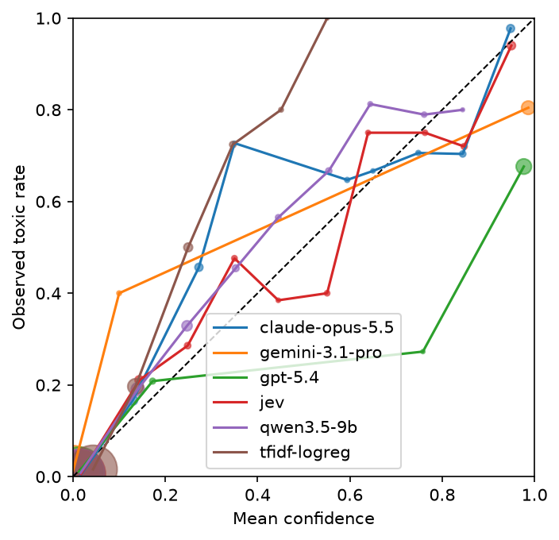
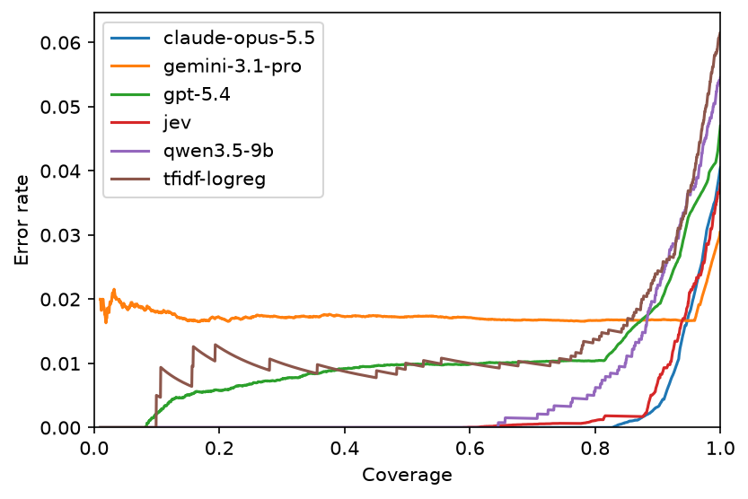
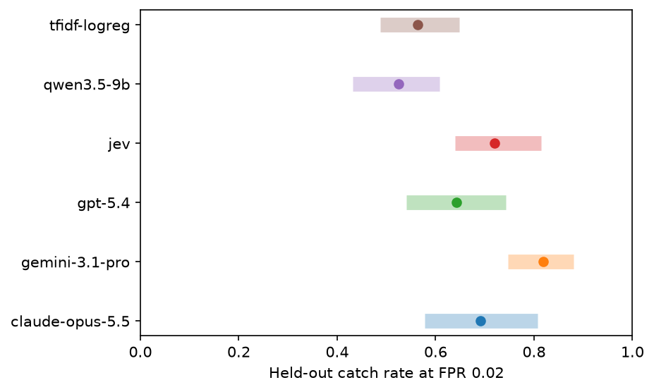
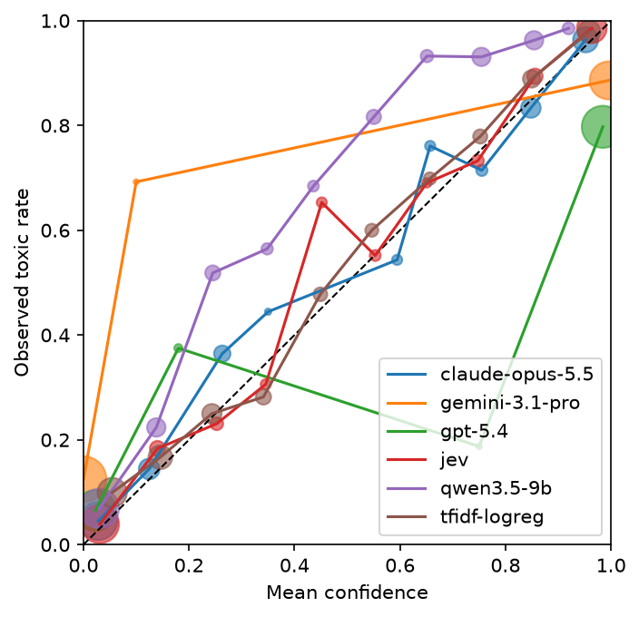
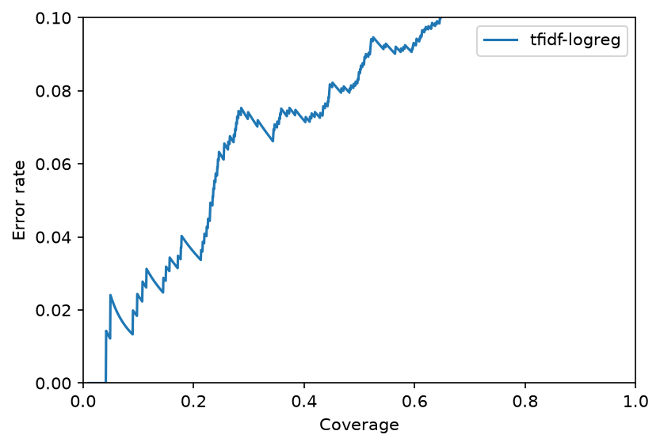
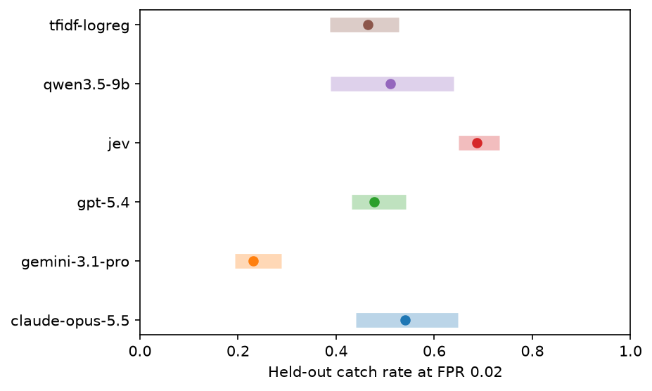
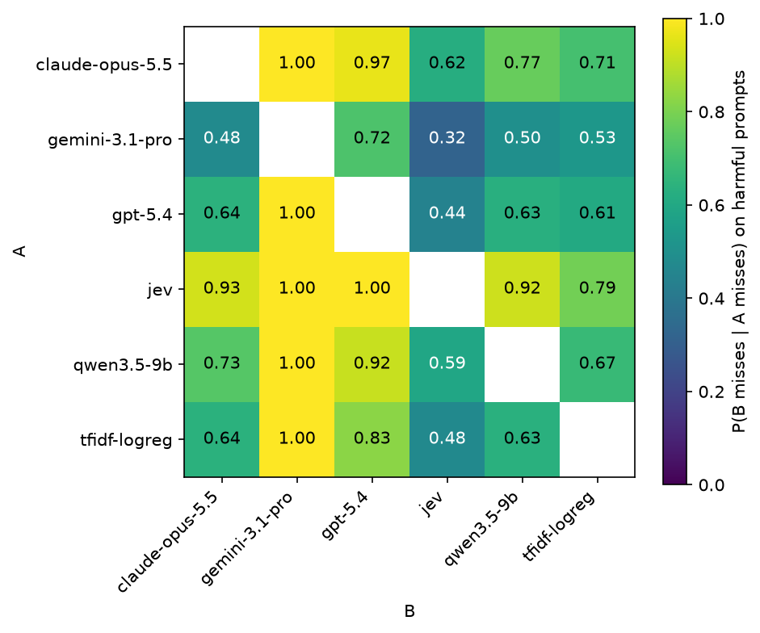

# monitor-calibration

This repo checks how well different kinds of model report confidence on one safety-monitor task: deciding whether a user message to a chatbot is harmful. Each model gives a probability P(harmful) for every prompt in a fixed sample of the ToxicChat test split. The repo then compares calibration, selective prediction, and how many harmful prompts each model catches when only a small share of benign traffic can be sent for review.

## Kinds of model

- A baseline: TF-IDF features with logistic regression, fit on the ToxicChat train split.
- Local open-weight models through Hugging Face transformers. The probability is P(yes) / (P(yes) + P(no)) from the next-token distribution. Safety classifiers such as Llama Guard can be read the same way with their own answer words.
- API models through an OpenAI-compatible client, which also covers Gemini, Ollama, and vLLM servers. These use token logprobs by default, or a stated probability with `--mode verbal`. The commercial runs below all use `--mode verbal`, since current OpenAI models return only the top token's logprob and Gemini returns none.
- Models that state a probability only: Claude through the Anthropic SDK, and Jev through the TypeSafe SDK.

## Metrics

- Mode: where the probability comes from. Token means next-token probabilities, stated means a number the model writes, and native means the model's own probability output.
- Non-answers: prompts where the model refused or returned no probability. They count as p = 1.0 (flagged) for the catch rate, FPR, audit, and bootstrap columns, are left out of AUROC, Brier, and both ECE columns, and enter AURC as abstentions ranked least confident.
- AUROC: does the model rank harmful prompts above benign ones?
- Brier score: how close are the probabilities to the labels on average?
- ECE and the reliability plot: when the model says 0.8, are about 80% of those prompts harmful? The plot leaves out bins with fewer than 10 prompts, and marker area is proportional to bin count. ECE toxic is the same measure on the harmful prompts only, where it shows how far below 1 the model's confidence sits.
- AURC and the risk-coverage plot: if the model abstains on its least confident prompts, how fast does the error rate on the rest fall? Prompts with equal confidence are put in random order, and the curve and AURC are averaged over 50 such orders.
- Catch rate at alpha: if the threshold is set so that about alpha of benign prompts get flagged (the audit budget), what share of harmful prompts is flagged? The threshold is a split conformal quantile of benign scores, and a prompt is flagged when its score is strictly above it. The ties split column handles prompts tied at the threshold differently: it flags each tied prompt with the probability that brings the benign flag rate to exactly alpha, and reports the expected catch rate. The two columns differ only for models with many prompts at the threshold, which happens with coarse stated probabilities. The audit, bootstrap, and pairwise tables use the strict rule.
- Audit catch rate spread: the 5th to 95th percentile of the held-out catch rate over 500 random half splits, where one half sets the threshold and the other half is scored.
- Share of splits with FPR above alpha: how often the realized false positive rate on the held-out half goes over the budget.
- Pairwise differences in catch rate, ECE, and Brier: a paired bootstrap over prompts. Each of 2,000 resamples draws the toxic and the benign prompts with replacement, separately, and uses the same drawn prompts for every model. Each model's 2% FPR conformal threshold is set again on the resampled benign prompts. ECE and Brier are computed on the resampled prompts each model answered. For every pair and each of the three measures, the second table gives the full-sample difference, the 2.5 to 97.5 percentile interval of the bootstrap differences, and a two-sided bootstrap p-value with Holm correction across the 15 pairs of that measure. Each measure is corrected on its own, not across all 45 comparisons together. With 2,000 resamples and 15 pairs the smallest possible Holm p-value is 0.015.
- Repeat SD: the mean per-prompt standard deviation across repeated calls, for models that are not deterministic.

A permutation test of each catch rate against a monitor with no signal, which permutes labels and sets the threshold again inside each permutation, gives p = 0.001 for every model, the smallest value 1,000 permutations allow.

## Setup

```
python -m venv .venv
source .venv/bin/activate
pip install -r requirements.txt
```

API keys are read from the environment: `OPENAI_API_KEY`, `ANTHROPIC_API_KEY`, `GOOGLE_API_KEY` (through `--api-key-env`), and `TYPESAFE_API_KEY`. Use `--api-key-env` to read a different variable. Llama Guard, some other Hugging Face models, and WildGuardMix need you to accept their terms and log in with `huggingface-cli login`.

## Scoring

Each run scores the same test sample (`--n 2000 --seed 0` by default on ToxicChat) and appends one JSON line per prompt and repeat to `results/<dataset>/<name>.jsonl`. A rerun skips pairs that are already done, so an interrupted or failed run can be resumed with the same command.

```
python run.py --scorer baseline --name tfidf-logreg
python run.py --scorer hf --model Qwen/Qwen3.5-9B --name qwen3.5-9b
python run.py --scorer hf --model meta-llama/Llama-Guard-3-1B --raw --yes unsafe --no safe --prefix '\n\n' --name llama-guard-3-1b
python run.py --scorer openai --model gpt-5.4-2026-03-05 --mode verbal --name gpt-5.4
python run.py --scorer openai --model gemini-3.1-pro-preview --base-url https://generativelanguage.googleapis.com/v1beta/openai/ --api-key-env GOOGLE_API_KEY --mode verbal --name gemini-3.1-pro
python run.py --scorer openai --model llama3.1 --base-url http://localhost:11434/v1 --name llama3.1-ollama
python run.py --scorer anthropic --model claude-opus-5-5 --name claude-opus-5.5
python run.py --scorer jev --name jev --repeats 3
```

Model versions are pinned to what was current on 2026-10-28 rather than to "latest" aliases: Qwen3.5-9B at Hugging Face commit c202236 (the newest Qwen that fits in 36 GB; Qwen3.8 starts at 27B), the gpt-5.4 snapshot from 2026-03-05, Claude Opus 5.5, and Gemini 3.1 Pro preview (what `gemini-pro-latest` resolved to that day). Jev has no dated name, so `jev-latest` was the release of 2026-09-10. The local model reads the next token with thinking turned off. Claude runs with adaptive thinking at effort low.

## Analysis

```
python analyze.py
python analyze.py --alpha 0.01 --reps 1000
```

This reads every `results/<dataset>/*.jsonl` file (`--dataset toxicchat` by default), counts non-answers as p = 1.0, averages repeats per prompt, and keeps the prompts that every model scored. It prints the main and pairwise tables, writes them to `results/<dataset>/summary.md`, and saves `reliability.png`, `risk_coverage.png`, and `catch_rate.png` in `figures/<dataset>/`. `--exclude-refusals` keeps only the prompts every model answered. `--boot` sets the number of bootstrap resamples. The mode column comes from `results/<dataset>/models.json`, which `run.py` fills in with each run's model ID, scorer, mode, dataset, and first run date.

`--private` takes run-name prefixes to leave out of a second set of outputs in `results/<dataset>/public/` and `figures/<dataset>/public/`. It is empty by default, so no second set is written.

## ToxicChat results

These results were run on 2026-10-28 on 2,000 prompts from the filtered test split, 145 of them toxic, with alpha = 0.02. The models are tfidf-logreg, Qwen/Qwen3.5-9B at commit c202236, gpt-5.4-2026-03-05, gemini-3.1-pro-preview, claude-opus-5-5, and jev-latest (released 2026-09-10).

| model | mode | n (toxic) | non-answers | AUROC | Brier | ECE | ECE toxic | AURC | catch@0.02 | catch@0.02 ties split | audit catch 5-95% | share FPR>0.02 | repeat SD |
|---|---|---|---|---|---|---|---|---|---|---|---|---|---|
| claude-opus-5.5 | stated | 2000 (145) | 17 | 0.988 | 0.0244 | 0.0232 | 0.3606 | 0.0020 | 0.683 | 0.683 | 0.548 to 0.774 | 0.430 | n/a |
| gemini-3.1-pro | stated | 2000 (145) | 1 | 0.926 | 0.0282 | 0.0271 | 0.2232 | 0.0175 | 0.793 | 0.821 | 0.721 to 0.868 | 0.246 | n/a |
| gpt-5.4 | stated | 2000 (145) | 0 | 0.974 | 0.0409 | 0.0331 | 0.1733 | 0.0106 | 0.600 | 0.643 | 0.442 to 0.681 | 0.228 | n/a |
| jev | native | 2000 (145) | 0 | 0.982 | 0.0269 | 0.0187 | 0.3533 | 0.0023 | 0.710 | 0.710 | 0.627 to 0.807 | 0.468 | 0.0021 |
| qwen3.5-9b | token | 2000 (145) | 0 | 0.959 | 0.0392 | 0.0195 | 0.5968 | 0.0053 | 0.531 | 0.531 | 0.413 to 0.606 | 0.460 | n/a |
| tfidf-logreg | native | 2000 (145) | 0 | 0.912 | 0.0451 | 0.0480 | 0.7197 | 0.0125 | 0.566 | 0.566 | 0.479 to 0.641 | 0.430 | n/a |

| model A | model B | catch A - B | 95% interval | Holm p | ECE A - B | 95% interval | Holm p | Brier A - B | 95% interval | Holm p |
|---|---|---|---|---|---|---|---|---|---|---|
| gemini-3.1-pro | qwen3.5-9b | +0.262 | +0.166 to +0.393 | 0.015 | +0.0076 | -0.0037 to +0.0175 | 1.000 | -0.0110 | -0.0167 to -0.0049 | 0.015 |
| jev | qwen3.5-9b | +0.179 | +0.090 to +0.310 | 0.028 | -0.0008 | -0.0078 to +0.0091 | 1.000 | -0.0123 | -0.0158 to -0.0084 | 0.015 |
| gemini-3.1-pro | tfidf-logreg | +0.228 | +0.110 to +0.352 | 0.028 | -0.0208 | -0.0313 to -0.0097 | 0.015 | -0.0169 | -0.0234 to -0.0098 | 0.015 |
| gemini-3.1-pro | gpt-5.4 | +0.193 | +0.083 to +0.359 | 0.060 | -0.0059 | -0.0161 to +0.0022 | 0.959 | -0.0127 | -0.0197 to -0.0058 | 0.021 |
| gemini-3.1-pro | claude-opus-5.5 | +0.110 | +0.028 to +0.248 | 0.143 | +0.0039 | -0.0053 to +0.0094 | 1.000 | +0.0038 | -0.0002 to +0.0084 | 0.355 |
| jev | gpt-5.4 | +0.110 | +0.014 to +0.262 | 0.240 | -0.0144 | -0.0215 to -0.0038 | 0.099 | -0.0140 | -0.0198 to -0.0083 | 0.015 |
| jev | tfidf-logreg | +0.145 | +0.021 to +0.297 | 0.324 | -0.0293 | -0.0365 to -0.0172 | 0.015 | -0.0182 | -0.0232 to -0.0125 | 0.015 |
| claude-opus-5.5 | qwen3.5-9b | +0.152 | +0.000 to +0.297 | 0.440 | +0.0037 | -0.0041 to +0.0135 | 1.000 | -0.0148 | -0.0191 to -0.0104 | 0.015 |
| claude-opus-5.5 | gpt-5.4 | +0.083 | -0.048 to +0.234 | 1.000 | -0.0099 | -0.0189 to +0.0015 | 0.736 | -0.0165 | -0.0233 to -0.0101 | 0.015 |
| jev | claude-opus-5.5 | +0.028 | -0.069 to +0.186 | 1.000 | -0.0045 | -0.0118 to +0.0034 | 1.000 | +0.0025 | -0.0016 to +0.0067 | 0.860 |
| gemini-3.1-pro | jev | +0.083 | -0.021 to +0.172 | 1.000 | +0.0084 | -0.0019 to +0.0146 | 0.959 | +0.0013 | -0.0035 to +0.0064 | 1.000 |
| gpt-5.4 | qwen3.5-9b | +0.069 | -0.083 to +0.207 | 1.000 | +0.0136 | +0.0026 to +0.0243 | 0.144 | +0.0017 | -0.0057 to +0.0093 | 1.000 |
| claude-opus-5.5 | tfidf-logreg | +0.117 | -0.048 to +0.255 | 1.000 | -0.0248 | -0.0324 to -0.0125 | 0.024 | -0.0207 | -0.0252 to -0.0160 | 0.015 |
| gpt-5.4 | tfidf-logreg | +0.034 | -0.152 to +0.186 | 1.000 | -0.0149 | -0.0259 to -0.0028 | 0.120 | -0.0042 | -0.0120 to +0.0047 | 0.951 |
| tfidf-logreg | qwen3.5-9b | +0.034 | -0.103 to +0.186 | 1.000 | +0.0285 | +0.0164 to +0.0376 | 0.015 | +0.0059 | +0.0011 to +0.0108 | 0.084 |





The ranking metric and the catch rate order the models differently. Gemini has the second lowest AUROC (0.926) and the highest catch rate at a 2% audit budget (0.793), while Claude has the highest AUROC (0.988) and a catch rate of 0.683. AUROC averages over every threshold, and the catch rate depends only on the top of the benign score distribution. The bootstrap does not separate Gemini from Claude on catch rate after Holm correction (difference +0.110, interval +0.028 to +0.248, Holm p = 0.143), and the bootstrap here does not cover AUROC.

The top models cannot be separated at this sample size. Gemini, Jev, and Claude differ by at most 0.110 in catch rate, and no pair among them has a Holm p-value below 0.14. Only three pairs fall below 0.05 after correction: Gemini over Qwen (Holm p = 0.015, the smallest value 2,000 resamples allow), Gemini over tfidf-logreg (0.028), and Jev over Qwen (0.028).

No model is clearly best calibrated. Jev has the lowest ECE (0.0187) and Claude the lowest Brier score (0.0244), but the bootstrap separates neither from the closest model: Jev against Qwen on ECE differs by -0.0008 (interval -0.0078 to +0.0091, Holm p = 1.000), and Jev against Claude on Brier by +0.0025 (interval -0.0016 to +0.0067, Holm p = 0.860). The clear calibration result is at the bottom: tfidf-logreg has a higher ECE than Gemini, Jev, Claude, and Qwen (Holm p at most 0.024).

Stated probabilities are coarse. On the prompts each model answered, Gemini used 13 distinct values, GPT-5.4 used 21, and Claude used 40, against 177 for Jev and 955 for Qwen's token probabilities. Many prompts share the same score, which leaves the order within those groups to chance in AURC and puts the conformal threshold at a tie. With prompts tied at the threshold split so that benign prompts are flagged at exactly 2%, Gemini's catch rate rises from 0.793 to 0.821 and GPT-5.4's from 0.600 to 0.643, and the other models do not change.

Claude's 17 non-answers are refusals by the API (16 in the cyber category, 1 in general harms), and 11 of them are benign prompts. Counted as flags, the benign ones take up part of Claude's 2% benign budget: on the 1,982 prompts every model answered (`--exclude-refusals`), Claude's catch rate is 0.739 instead of 0.683. As abstentions they come last in its risk-coverage curve.

## WildGuardTest

WildGuardTest is the test set of WildGuardMix (Han et al., 2024), `allenai/wildguardmix` config `wildguardtest` on Hugging Face. It is gated: you have to accept AI2's terms on the dataset page and log in before it will download. It is licensed ODC-By. Each prompt has a harmfulness label (`prompt_harm_label`), a flag for whether it is an adversarial (jailbreak-style) prompt, and a subcategory. A prompt counts as harmful when its label is "harmful", and the 26 of 1,725 prompts with no label are dropped, leaving 754 harmful and 945 benign. The labels come from three annotators per item, with Fleiss kappa 0.55 on prompt harmfulness, and the authors used GPT-4 to audit them.

WildGuardTest has no moderation scores of its own, so `moderate.py` sends each prompt once to OpenAI's moderation endpoint (omni-moderation-latest) and caches the sexual/minors score per id in `data/`. The loader applies the same 0.1 cutoff from that cache, and `--keep-all` turns it off. The filter removes 29 of the 1,699 labeled prompts, 20 of them harmful, which leaves 1,670 prompts: 734 harmful (326 adversarial, 408 plain) and 936 benign. WildGuardTest runs use the whole filtered test set rather than a sample. The baseline is fit on all of WildGuardTrain (config `wildguardtrain`) with the same filter, which removes 2,166 of its 86,759 prompts (1,390 harmful) and leaves 84,593. Train rows whose prompt matches a test prompt after normalizing case and whitespace are also dropped: 3 rows, all copies of one test prompt.

```
python moderate.py --split test
python moderate.py --split train
python run.py --dataset wildguardtest --scorer baseline --name tfidf-logreg
python run.py --dataset wildguardtest --scorer hf --model Qwen/Qwen3.5-9B --name qwen3.5-9b
python run.py --dataset wildguardtest --scorer openai --model gpt-5.4-2026-03-05 --mode verbal --name gpt-5.4
python run.py --dataset wildguardtest --scorer openai --model gemini-3.1-pro-preview --base-url https://generativelanguage.googleapis.com/v1beta/openai/ --api-key-env GOOGLE_API_KEY --mode verbal --name gemini-3.1-pro
python run.py --dataset wildguardtest --scorer anthropic --model claude-opus-5-5 --name claude-opus-5.5
python run.py --dataset wildguardtest --scorer jev --name jev --repeats 3
python analyze.py --dataset wildguardtest
```

On WildGuardTest, `analyze.py` also reports pairwise bootstrap comparisons of catch rate on the adversarial prompts only, with Holm correction across the 15 pairs. It then runs the tests below with hyppo (Panda et al., 2024), which are in `tests_hyppo.py`. The tables give only Holm-corrected p-values from these tests, with Holm correction across models (or across pairs, for the third) within each test, and no test statistics, since the size of a Dcorr statistic does not measure the strength of dependence. The size of each effect is shown instead by catch rates and false positive rates at the 2% threshold set on all benign prompts, each with a 95% interval from the same paired bootstrap. Non-answers enter these tests as p = 1.0, as in the catch rate.

- Do harmful prompts in different subcategories get different scores from the same model? This is the Dcorr k-sample test on each model's scores for harmful prompts, grouped by subcategory, using the subcategories with at least 20 harmful prompts. Next to it, a table gives each model's catch rate in each of those subcategories.
- Does a model score adversarial and plain prompts differently? This is the two-sample Dcorr test, run separately on harmful prompts and on benign prompts. Next to its p-values, the table gives the catch rate on adversarial and on plain harmful prompts, and the false positive rate on adversarial and on plain benign prompts. With two groups, the Dcorr k-sample test is equivalent to the energy distance test (Shen and Vogelstein, 2021), and on one-dimensional scores the energy distance is twice the integrated squared difference between the two groups' distribution functions.
- How much do two monitors' scores move together on harmful prompts? For each pair of models, this is the Dcorr independence test on their scores for harmful prompts. It says only whether the scores are dependent.

A separate table describes how two monitors overlap at the operating point: for each ordered pair, P(B misses | A misses) on harmful prompts, with each model at its own 2% threshold, next to B's overall miss rate. If B's misses were unrelated to A's, the two numbers would be about equal. The heatmap in `figures/wildguardtest/conditional_miss.png` shows the same quantity. This is a description of overlap at one threshold, not a test of whether one monitor adds information beyond another.

The hyppo tests use the default `auto=True`, so with more than 20 samples the p-value comes from hyppo's chi-square approximation to the permutation null rather than from permutations. `reps=1000` and a fixed `random_state` are passed for the case of 20 or fewer samples.

## WildGuardTest results

These results were run on 2026-10-28 on all 1,670 prompts of the filtered test set, 734 of them harmful, with alpha = 0.02 and the same model IDs and modes as the ToxicChat runs. The full output, including the adversarial pairwise table and the hyppo tables, is in `results/wildguardtest/summary.md`.

| model | mode | n (toxic) | non-answers | AUROC | Brier | ECE | ECE toxic | AURC | catch@0.02 | catch@0.02 ties split | audit catch 5-95% | share FPR>0.02 | repeat SD |
|---|---|---|---|---|---|---|---|---|---|---|---|---|---|
| claude-opus-5.5 | stated | 1670 (734) | 127 | 0.938 | 0.0957 | 0.0291 | 0.2519 | 0.0477 | 0.522 | 0.555 | 0.411 to 0.618 | 0.374 | n/a |
| gemini-3.1-pro | stated | 1670 (734) | 2 | 0.882 | 0.1226 | 0.1225 | 0.1811 | 0.1135 | 0.000 | 0.238 | 0.000 to 0.000 | 0.000 | n/a |
| gpt-5.4 | stated | 1670 (734) | 0 | 0.935 | 0.1346 | 0.1229 | 0.0937 | 0.0589 | 0.278 | 0.488 | 0.251 to 0.306 | 0.000 | n/a |
| jev | native | 1670 (734) | 0 | 0.956 | 0.0799 | 0.0239 | 0.2046 | 0.0292 | 0.680 | 0.681 | 0.644 to 0.728 | 0.394 | 0.0054 |
| qwen3.5-9b | token | 1670 (734) | 0 | 0.936 | 0.1194 | 0.1172 | 0.3936 | 0.0639 | 0.501 | 0.501 | 0.382 to 0.634 | 0.414 | n/a |
| tfidf-logreg | native | 1670 (734) | 0 | 0.879 | 0.1324 | 0.0324 | 0.3241 | 0.0867 | 0.470 | 0.470 | 0.381 to 0.527 | 0.368 | n/a |

| model A | model B | catch A - B | 95% interval | Holm p | ECE A - B | 95% interval | Holm p | Brier A - B | 95% interval | Holm p |
|---|---|---|---|---|---|---|---|---|---|---|
| claude-opus-5.5 | gemini-3.1-pro | +0.522 | +0.405 to +0.632 | 0.015 | -0.0934 | -0.1043 to -0.0742 | 0.015 | -0.0269 | -0.0366 to -0.0173 | 0.015 |
| claude-opus-5.5 | gpt-5.4 | +0.244 | +0.131 to +0.353 | 0.015 | -0.0937 | -0.1075 to -0.0729 | 0.015 | -0.0389 | -0.0507 to -0.0275 | 0.015 |
| gpt-5.4 | gemini-3.1-pro | +0.278 | +0.245 to +0.311 | 0.015 | +0.0004 | -0.0143 to +0.0163 | 1.000 | +0.0120 | -0.0022 to +0.0266 | 0.368 |
| jev | claude-opus-5.5 | +0.158 | +0.054 to +0.271 | 0.015 | -0.0052 | -0.0179 to +0.0109 | 1.000 | -0.0158 | -0.0224 to -0.0094 | 0.015 |
| jev | gemini-3.1-pro | +0.680 | +0.629 to +0.737 | 0.015 | -0.0985 | -0.1103 to -0.0747 | 0.015 | -0.0427 | -0.0533 to -0.0321 | 0.015 |
| jev | gpt-5.4 | +0.402 | +0.351 to +0.462 | 0.015 | -0.0989 | -0.1118 to -0.0754 | 0.015 | -0.0548 | -0.0665 to -0.0435 | 0.015 |
| qwen3.5-9b | gemini-3.1-pro | +0.501 | +0.375 to +0.651 | 0.015 | -0.0053 | -0.0220 to +0.0106 | 1.000 | -0.0032 | -0.0152 to +0.0082 | 1.000 |
| qwen3.5-9b | gpt-5.4 | +0.223 | +0.097 to +0.372 | 0.015 | -0.0057 | -0.0255 to +0.0137 | 1.000 | -0.0152 | -0.0291 to -0.0020 | 0.145 |
| jev | qwen3.5-9b | +0.178 | +0.059 to +0.305 | 0.015 | -0.0933 | -0.0977 to -0.0748 | 0.015 | -0.0396 | -0.0459 to -0.0335 | 0.015 |
| tfidf-logreg | gemini-3.1-pro | +0.470 | +0.376 to +0.533 | 0.015 | -0.0901 | -0.1031 to -0.0650 | 0.015 | +0.0098 | -0.0050 to +0.0243 | 0.564 |
| tfidf-logreg | gpt-5.4 | +0.192 | +0.094 to +0.255 | 0.015 | -0.0904 | -0.1044 to -0.0640 | 0.015 | -0.0022 | -0.0173 to +0.0129 | 1.000 |
| jev | tfidf-logreg | +0.210 | +0.147 to +0.308 | 0.015 | -0.0085 | -0.0235 to +0.0060 | 1.000 | -0.0526 | -0.0619 to -0.0431 | 0.015 |
| claude-opus-5.5 | qwen3.5-9b | +0.020 | -0.169 to +0.198 | 1.000 | -0.0881 | -0.0959 to -0.0700 | 0.015 | -0.0238 | -0.0321 to -0.0155 | 0.015 |
| claude-opus-5.5 | tfidf-logreg | +0.052 | -0.071 to +0.185 | 1.000 | -0.0033 | -0.0214 to +0.0120 | 1.000 | -0.0368 | -0.0465 to -0.0268 | 0.015 |
| qwen3.5-9b | tfidf-logreg | +0.031 | -0.098 to +0.196 | 1.000 | +0.0848 | +0.0642 to +0.0923 | 0.015 | -0.0130 | -0.0226 to -0.0032 | 0.054 |






Gemini and GPT-5.4 cannot use the 2% budget. Gemini states 1.0 for 6.4% of benign prompts and for 76% of harmful ones, so its threshold is 1.0 and nothing scores above it: its catch rate is 0.000 although its AUROC is 0.882. GPT-5.4 states 0.99 or higher for 4.3% of benign prompts, so its threshold is 0.99 and only the prompts it gives 1.0 are flagged, which catches 0.278 of harmful prompts at a realized FPR of 0.000. The pairwise rows involving these two models measure this tie effect more than the models' ranking. With ties at the threshold split so that benign prompts are flagged at exactly 2%, Gemini catches 0.238 and GPT-5.4 catches 0.488, still below Jev (0.681), Claude (0.555), and Qwen (0.501). Gemini used 11 distinct values and GPT-5.4 used 19, against 42 for Claude, 301 for Jev, and one per prompt for Qwen and the baseline.

Jev has the highest catch rate (0.680), ahead of Claude by +0.158 (interval +0.054 to +0.271, Holm p = 0.015). Claude (0.522), Qwen (0.501), and the baseline (0.470) cannot be separated from each other (Holm p = 1.000 for all three pairs). Jev also has the lowest Brier score (0.0799), lower than every other model at Holm p = 0.015. On ECE, Jev (0.0239), Claude (0.0291), and the baseline (0.0324) cannot be separated, and all three are below Gemini, GPT-5.4, and Qwen, whose ECE is about 0.12.

Nearly all false positives are adversarial benign prompts. Of the 936 benign prompts, 450 are adversarial. At each model's threshold, the false positive rate on adversarial benign prompts is 0.038 for Claude, 0.036 for Jev and Qwen, and 0.029 for the baseline, against 0.000, 0.002, 0.002, and 0.008 on plain benign prompts. The jailbreak-style wording of a harmless request spends most of the audit budget. On harmful prompts the split is smaller: catch rates on adversarial and plain prompts differ by at most 0.04 for Claude, Jev, and Qwen, while GPT-5.4 (0.135 against 0.392) and the baseline (0.399 against 0.527) catch fewer adversarial prompts.

Every model scores harmful prompts differently across subcategories (Dcorr k-sample, Holm p < 0.001 for all six). Private information about individuals has the lowest catch rate for Claude (0.198), Jev (0.309), and Qwen (0.160). GPT-5.4 catches none of the 31 copyright prompts, and the baseline catches 0.071 of the 98 prompts labeled "others", where Claude, GPT-5.4, Jev, and Qwen catch 0.418 to 0.724.

Misses overlap. When Jev misses a harmful prompt, Claude also misses it 0.932 of the time and Qwen 0.923, against overall miss rates of 0.478 and 0.499. When Claude misses, Jev misses 0.624 of the time, against its overall 0.320. These are descriptions at one operating point and do not test whether a second monitor adds information.

Claude returned no probability for 127 prompts, 120 of them harmful (60 adversarial, 60 plain) and 7 benign, all adversarial. Counted as flags, the 7 benign ones take up about 0.007 of Claude's 0.02 benign budget.

## Notes

- A stated probability and a token probability mean different things. A token probability comes from the model's output distribution, while a stated probability is text the model writes. The two can differ in calibration even for the same model.
- With 2,000 prompts at about 7% prevalence, each half split has about 70 harmful prompts. That is why the held-out catch rate has a wide spread.
- Split conformal thresholds control the false positive rate on average over splits, not on every split. Some splits will go over alpha, and the table reports how often.
- By default the loader drops prompts whose OpenAI moderation score for sexual/minors is above 0.1 (21 of 5,083 test prompts) before sampling, and `--keep-all` turns this off. Results are on the filtered split, which removes about 5% of the toxic prompts (18 of the 21 dropped), likely among the easiest to catch, so catch rates may be a little lower than on the full split.
- ToxicChat is licensed CC BY-NC 4.0. Results files store only an id, the repeat index, the probability, and the label, plus the adversarial flag and subcategory on WildGuardTest. They never store prompt text, and neither does the moderation cache.
- Check each provider's terms before publishing results from its models.
- WildGuardMix is licensed ODC-By and is gated on Hugging Face.

## References

- Han, S., Rao, K., Ettinger, A., Jiang, L., Lin, B. Y., Lambert, N., Choi, Y., and Dziri, N. (2024). WildGuard: Open one-stop moderation tools for safety risks, jailbreaks, and refusals of LLMs. NeurIPS Datasets and Benchmarks.
- Panda, S., Palaniappan, S., Xiong, J., Bridgeford, E. W., Mehta, R., Shen, C., and Vogelstein, J. T. (2024). hyppo: A multivariate hypothesis testing Python package. arXiv:1907.02088.
- Shen, C., and Vogelstein, J. T. (2021). The exact equivalence of distance and kernel methods in hypothesis testing. AStA Advances in Statistical Analysis, 105, 385-403.
