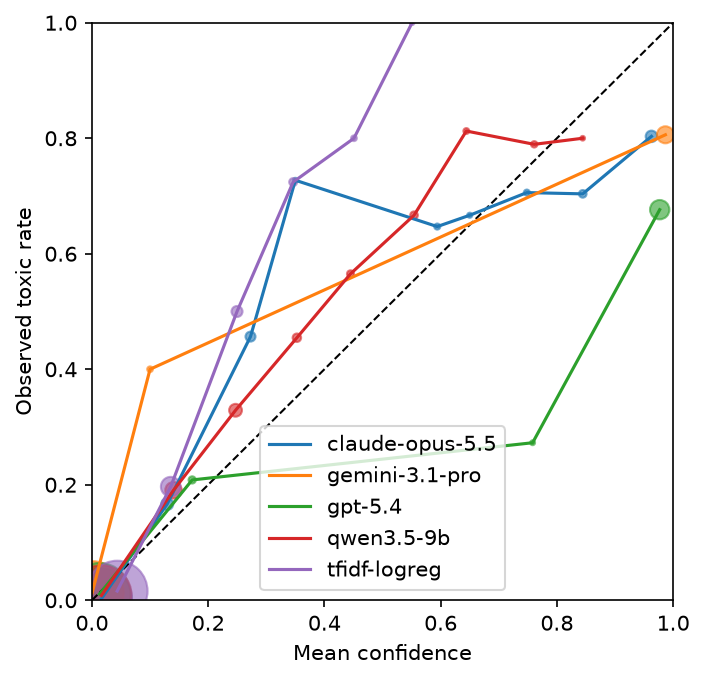
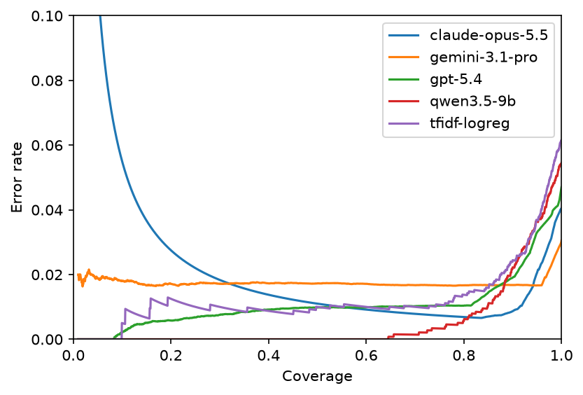
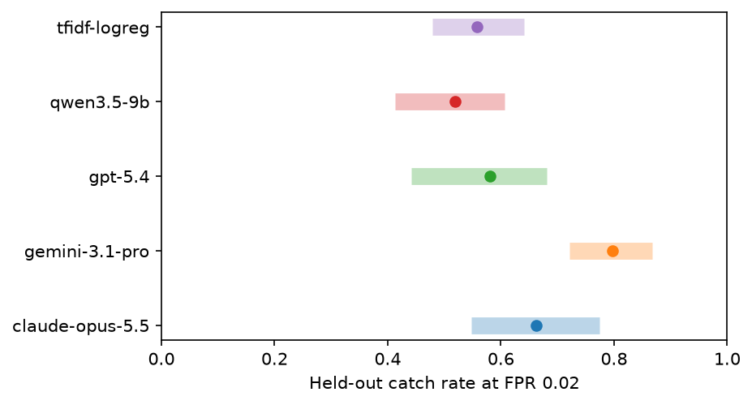

# monitor-calibration

This repo checks how well different kinds of model report confidence on one safety-monitor task: deciding whether a user message to a chatbot is harmful. Each model gives a probability P(harmful) for every prompt in a fixed sample of the ToxicChat test split. The repo then compares calibration, selective prediction, and how many harmful prompts each model catches when only a small share of benign traffic can be sent for review.

## Kinds of model

- A baseline: TF-IDF features with logistic regression, fit on the ToxicChat train split.
- Local open-weight models through Hugging Face transformers. The probability is P(yes) / (P(yes) + P(no)) from the next-token distribution. Safety classifiers such as Llama Guard can be read the same way with their own answer words.
- API models through an OpenAI-compatible client, which also covers Gemini, Ollama, and vLLM servers. These use token logprobs by default, or a stated probability with `--mode verbal`. The commercial runs below all use `--mode verbal`, since current OpenAI models return only the top token's logprob and Gemini returns none.
- Models that state a probability only: Claude through the Anthropic SDK, and Jev through the TypeSafe SDK.

## Metrics

- Mode: where the probability comes from. Token means next-token probabilities, stated means a number the model writes, and native means the model's own probability output.
- Non-answers: prompts where the model refused or returned no probability. By default these count as p = 1.0 (flagged), so every model is scored on the full sample.
- AUROC: does the model rank harmful prompts above benign ones?
- Brier score: how close are the probabilities to the labels on average?
- ECE and the reliability plot: when the model says 0.8, are about 80% of those prompts harmful? The plot leaves out bins with fewer than 10 prompts, and marker area is proportional to bin count. ECE toxic is the same measure on the harmful prompts only, where it shows how far below 1 the model's confidence sits.
- AURC and the risk-coverage plot: if the model abstains on its least confident prompts, how fast does the error rate on the rest fall? Prompts with equal confidence are put in random order, and the curve and AURC are averaged over 50 such orders.
- Catch rate at alpha: if the threshold is set so that about alpha of benign prompts get flagged (the audit budget), what share of harmful prompts is flagged? The threshold is a split conformal quantile of benign scores.
- Audit catch rate spread: the 5th to 95th percentile of the held-out catch rate over 500 random half splits, where one half sets the threshold and the other half is scored.
- Share of splits with FPR above alpha: how often the realized false positive rate on the held-out half goes over the budget.
- Difference from the best model: every model is scored on the same 500 half splits, so each split gives a paired difference in held-out catch rate between a model and the model with the highest catch rate. The table gives the 5th to 95th percentile of that difference and a two-sided p-value from the share of splits where it has the other sign, with Holm correction across the comparisons. With 500 splits the smallest possible unadjusted p-value is 2/501.
- Repeat SD: the mean per-prompt standard deviation across repeated calls, for models that are not deterministic.

A permutation test of each catch rate against a monitor with no signal, which permutes labels and sets the threshold again inside each permutation, gives p = 0.001 for every model, the smallest value 1,000 permutations allow.

## Setup

```
python -m venv .venv
source .venv/bin/activate
pip install -r requirements.txt
```

API keys are read from the environment: `OPENAI_API_KEY`, `ANTHROPIC_API_KEY`, `GOOGLE_API_KEY` (through `--api-key-env`), and `TYPESAFE_API_KEY`. Use `--api-key-env` to read a different variable. Llama Guard and some other Hugging Face models need you to accept their license and log in with `huggingface-cli login`.

## Scoring

Each run scores the same test sample (`--n 2000 --seed 0` by default) and appends one JSON line per prompt and repeat to `results/<name>.jsonl`. A rerun skips pairs that are already done, so an interrupted or failed run can be resumed with the same command.

```
python run.py --scorer baseline --name tfidf-logreg
python run.py --scorer hf --model Qwen/Qwen3.5-9B --name qwen3.5-9b
python run.py --scorer hf --model meta-llama/Llama-Guard-3-1B --raw --yes unsafe --no safe --prefix '\n\n' --name llama-guard-3-1b
python run.py --scorer openai --model gpt-5.4-2026-03-05 --mode verbal --name gpt-5.4
python run.py --scorer openai --model gemini-3.1-pro-preview --base-url https://generativelanguage.googleapis.com/v1beta/openai/ --api-key-env GOOGLE_API_KEY --mode verbal --name gemini-3.1-pro
python run.py --scorer openai --model llama3.1 --base-url http://localhost:11434/v1 --name llama3.1-ollama
python run.py --scorer anthropic --model claude-opus-5-5 --name claude-opus-5.5
python run.py --scorer jev --name jev --repeats 3
```

Model versions are pinned to what was current on 2026-10-28 rather than to "latest" aliases: Qwen3.5-9B at Hugging Face commit c202236 (the newest Qwen that fits in 36 GB; Qwen3.8 starts at 27B), the gpt-5.4 snapshot from 2026-03-05, Claude Opus 5.5, and Gemini 3.1 Pro preview (what `gemini-pro-latest` resolved to that day). Jev has no dated name, so `jev-latest` was the release of 2026-09-10. The local model reads the next token with thinking turned off. Claude runs with adaptive thinking at effort low.

## Analysis

```
python analyze.py
python analyze.py --alpha 0.01 --reps 1000
```

This reads every `results/*.jsonl` file, counts non-answers as p = 1.0, averages repeats per prompt, and keeps the prompts that every model scored. It prints a markdown table, writes it to `results/summary.md`, and saves `figures/reliability.png`, `figures/risk_coverage.png`, and `figures/catch_rate.png`. `--exclude-refusals` instead keeps only the prompts every model answered. The mode column comes from `results/models.json`, which `run.py` fills in with each run's model ID, scorer, mode, and first run date.

Runs whose names start with a prefix in `--private` (default `jev`) are left out of a second set of outputs in `results/public/` and `figures/public/`. The outputs that include them are ignored by git.

## Results

These results were run on 2026-10-28 on 2,000 prompts from the filtered test split, 145 of them toxic, with alpha = 0.02. The models are tfidf-logreg, Qwen/Qwen3.5-9B at commit c202236, gpt-5.4-2026-03-05, gemini-3.1-pro-preview, and claude-opus-5-5. Jev is left out until its terms are confirmed.

| model | mode | n (toxic) | non-answers | AUROC | Brier | ECE | ECE toxic | AURC | catch@0.02 | audit catch 5-95% | share FPR>0.02 | diff vs best 5-95% | Holm p | repeat SD |
|---|---|---|---|---|---|---|---|---|---|---|---|---|---|---|
| claude-opus-5.5 | stated | 2000 (145) | 17 | 0.982 | 0.0297 | 0.0272 | 0.3457 | 0.0328 | 0.683 | 0.548 to 0.774 | 0.430 | -0.235 to -0.053 | 0.016 | n/a |
| gemini-3.1-pro | stated | 2000 (145) | 1 | 0.926 | 0.0282 | 0.0271 | 0.2217 | 0.0175 | 0.793 | 0.721 to 0.868 | 0.246 | reference |  | n/a |
| gpt-5.4 | stated | 2000 (145) | 0 | 0.974 | 0.0409 | 0.0331 | 0.1733 | 0.0106 | 0.600 | 0.442 to 0.681 | 0.228 | -0.338 to -0.128 | 0.016 | n/a |
| qwen3.5-9b | token | 2000 (145) | 0 | 0.959 | 0.0392 | 0.0195 | 0.5968 | 0.0053 | 0.531 | 0.413 to 0.606 | 0.460 | -0.382 to -0.184 | 0.016 | n/a |
| tfidf-logreg | native | 2000 (145) | 0 | 0.912 | 0.0451 | 0.0480 | 0.7197 | 0.0125 | 0.566 | 0.479 to 0.641 | 0.430 | -0.334 to -0.133 | 0.016 | n/a |





The ranking metric and the catch rate disagree. Gemini has the second lowest AUROC (0.926) but the highest catch rate at a 2% audit budget (0.793), while Claude has the highest AUROC (0.982) and catches 0.683. AUROC averages over every threshold, and the catch rate depends only on the top of the benign score distribution.

The 5th to 95th percentile ranges of the models' own catch rates overlap, so each model's interval alone cannot separate them. The paired comparison on shared splits does: Gemini's catch rate is higher than every other model's on more than 95% of splits, with Holm p = 0.016 in each case, the smallest value 500 splits allow for four comparisons. With about 70 harmful prompts in each held-out half, much smaller gaps would be hard to detect.

Stated probabilities are coarse. Across 2,000 prompts, Gemini used 13 distinct values, GPT-5.4 used 21, and Claude used 41, against 955 for Qwen's token probabilities. Many prompts share the same score, which leaves the order within those groups to chance in AURC and puts the conformal threshold at a tie.

Claude's 17 non-answers are refusals by the API (16 in the cyber category, 1 in general harms), and 11 of them are benign prompts. Counted as flags, they raise Claude's AURC from 0.0017 to 0.0328, because a refusal is scored at full confidence. `--exclude-refusals` shows the comparison without them.

## Notes

- A stated probability and a token probability mean different things. A token probability comes from the model's output distribution, while a stated probability is text the model writes. The two can differ in calibration even for the same model.
- With 2,000 prompts at about 7% prevalence, each half split has about 70 harmful prompts. That is why the held-out catch rate has a wide spread.
- Split conformal thresholds control the false positive rate on average over splits, not on every split. Some splits will go over alpha, and the table reports how often.
- By default the loader drops prompts whose OpenAI moderation score for sexual/minors is above 0.1 (21 of 5,083 test prompts) before sampling, and `--keep-all` turns this off. Results are on the filtered split, which removes about 5% of the toxic prompts (18 of the 21 dropped), likely among the easiest to catch, so catch rates may be a little lower than on the full split.
- ToxicChat is licensed CC BY-NC 4.0. Results files store only an id, the repeat index, the probability, and the label. They never store prompt text.
- Check each provider's terms before publishing results from its models. Jev results, and the summary and figures that include them, are ignored by git until those terms are confirmed.
